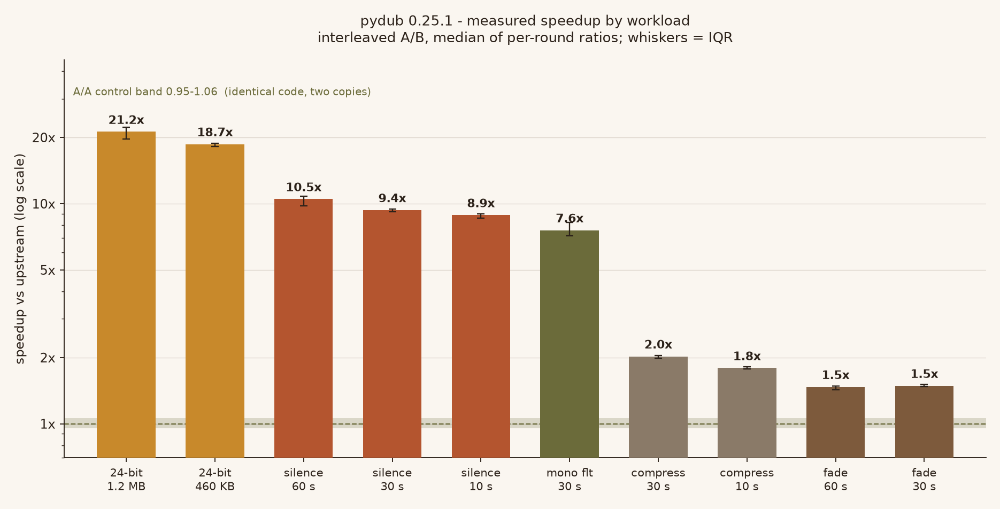
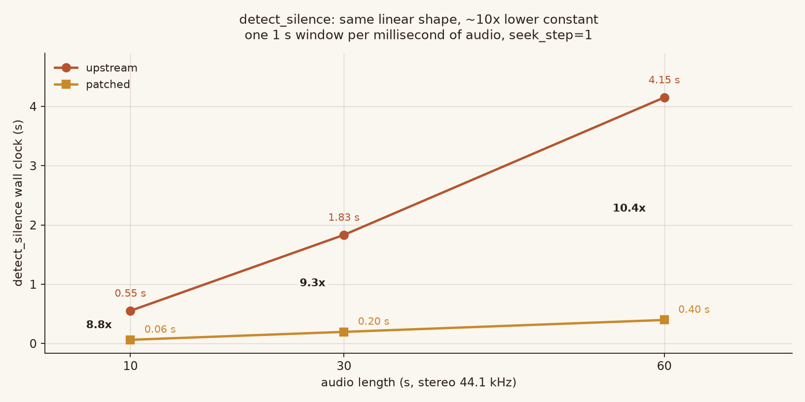
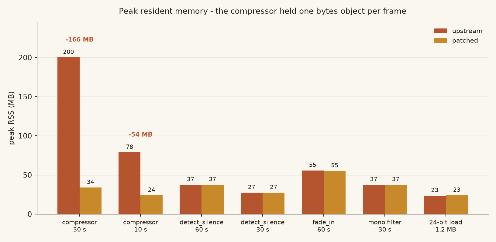

# pydub — audio fast paths

[](#compatibility)
[](LICENSE)
[](https://github.com/jiaaro/pydub)
[](#verification)

A performance fork of [pydub](https://github.com/jiaaro/pydub) 0.25.1. Three hot
functions rebuild an `AudioSegment` for every window, every sample frame, and
every sample, just to read `.rms` or `._data`. The results are correct; the
constant factor is enormous. This fork removes the per-window / per-frame object
churn and keeps every result **byte-identical**.

`detect_silence` on a 60 s stereo file goes from 4.15 s to 0.40 s (10.5x), and
`compress_dynamic_range` on 30 s drops from **200 MB of peak RSS to 34 MB** while
getting 2.0x faster.



## Measured effect

Interleaved A/B: both arms run in the same round, alternating, one fresh process
per (arm, case), 5 rounds. The reported figure is the **median of per-round
ratios**; the whiskers are the interquartile range. An A/A control — two
byte-identical copies of upstream — gives **0.954–1.059**, so anything under
about 1.06 is noise, not a win.

| workload | upstream | patched | speedup (IQR) | peak RSS |
|---|---|---|---|---|
| 24-bit load, 1.2 MB | 48.4 ms | 2.3 ms | **21.2x** (19.7–22.3) | 24 → 24 MB |
| 24-bit load, 460 KB | 18.5 ms | 1.1 ms | **18.7x** (18.2–18.9) | 20 → 20 MB |
| `detect_silence` 60 s | 4.152 s | 0.397 s | **10.5x** (9.8–10.8) | 37 → 37 MB |
| `detect_silence` 30 s | 1.833 s | 0.196 s | **9.4x** (9.2–9.5) | 27 → 27 MB |
| `detect_silence` 10 s | 0.552 s | 0.063 s | **8.9x** (8.6–9.0) | 21 → 21 MB |
| `apply_mono_filter_to_each_channel` 30 s | 0.209 s | 0.029 s | **7.6x** (7.2–8.2) | 38 → 38 MB |
| `compress_dynamic_range` 30 s | 4.068 s | 2.035 s | **2.0x** (2.0–2.0) | **200 → 34 MB** |
| `compress_dynamic_range` 10 s | 1.201 s | 0.664 s | **1.8x** (1.8–1.8) | **79 → 24 MB** |
| `fade_in` full 30 s | 70 ms | 47 ms | **1.5x** (1.5–1.5) | 37 → 37 MB |
| `fade_in` full 60 s | 142 ms | 96 ms | **1.5x** (1.4–1.5) | 56 → 55 MB |

All numbers come from `evidence/benchmark.json`; the control is
`evidence/noise_floor_aa.json`.

`detect_silence` does one 1 s window per millisecond of audio, so its cost is
linear in length for both arms — the patch lowers the constant, it does not
change the shape. That is what the next chart shows, on purpose: an absolute
plot, not a growth factor.



## What was slow

### 1. `silence.detect_silence` — one AudioSegment per window

```python
for i in slice_starts:
    audio_slice = audio_segment[i:i + min_silence_len]   # new object, new metadata dict
    if audio_slice.rms <= silence_thresh:                # audioop.rms over the window
```

With `seek_step=1` on a 60 s file that is **59 001 windows**, each one copying a
1 s slice and constructing an `AudioSegment` (plus a metadata dict, plus a
`frame_count()` float division) just to call `audioop.rms`. Profiling 30 s:
`audioop.rms` 1.86 s, `__getitem__` 0.70 s, `__init__` 0.13 s, `_spawn` 0.20 s.

The window is a *sliding* window: window `i+1` shares all but `seek_step`
milliseconds with window `i`. So the sum of squares can be updated instead of
recomputed:

```
sumsq(i+1) = sumsq(i) + sum_squares(entering) - sum_squares(leaving)
```

Two details make this bit-exact rather than approximately equal.

**Exact integer accumulation.** `audioop.rms` accumulates in a C `double`. Below
2^53 every sum of squares of 8/16-bit samples is exactly representable, so a
Python-int running sum, converted to float once for the `sqrt`, gives the
identical result. Verified over 300 random buffers across all three sample
widths: 0 mismatches.

**A fallback above 2^53.** A 16-bit window needs 8.4 M samples to get there
(190 s at 44.1 kHz), but it does happen: at 191 s the C double drifts to
**32766** while the exact value is **32767**. The reader detects the overflow and
defers to `audioop.rms` for that one window instead of returning a different
number. A threshold placed at 32766.5 separates the two — this is a reachable
branch, not defensive code, and there is a fixture that fails without it.

32-bit segments take the `audioop` branch directly: a 1 s window of 32-bit
samples already exceeds 2^53, so there is nothing to gain.

`_make_rms_reader` also reproduces `AudioSegment._parse_position()` exactly,
including the `int(ms * (frame_rate / 1000.0))` parenthesisation, because that
float rounding decides which frame a window starts on.

### 2. `effects.compress_dynamic_range` — one object and one `bytes` per frame

```python
for i in xrange(int(seg.frame_count())):
    rms_now = seg.get_sample_slice(frame_i - look_frames, frame_i).rms   # new AudioSegment
    ...
    frame = seg.get_frame(i)
    output.append(frame)                                                 # one bytes per frame
```

A 30 s stereo file is 1 323 000 frames. That is 1.3 M `AudioSegment` objects for
the RMS lookback plus 1.3 M `bytes` objects held in `output` until the final
`join` — measured peak **200 MB to carry 5 MB of audio**.

Three changes, each independently visible in the counters:

* the same sliding RMS reader, now keyed on frames rather than milliseconds;
* `max_attenuation` depends only on the integer `rms`, and real audio revisits
  the same value constantly (8742 distinct values across 441 000 frames), so the
  dB conversion is memoised — **309 794 → 8 741 calls**;
* frames are appended into a `bytearray` that flushes every 1 MiB instead of
  being retained as individual objects — peak traced allocation
  **54.4 → 4.1 MB**.



The envelope arithmetic is untouched, including `attenuation = max(attenuation, 0)`:
with a release shorter than one frame (0.02 ms) the value really does go
negative — down to **−263.9** on a real ramp — so the floor is load-bearing and
has its own regression test.

### 3. `AudioSegment.fade` — one AudioSegment per millisecond

```python
for i in range(duration):
    chunk = self[start + i]          # whole millisecond, as a new AudioSegment
    chunk = audioop.mul(chunk._data, self.sample_width, volume_change)
```

`self[i]` builds an object and re-derives its metadata only for `._data` to be
read on the next line. Slicing the raw buffer directly gives the same bytes.

One subtlety cost me a differential failure: `self[end:]` resolves `end` through
`__getitem__`, which clamps to `len(self)` — a *rounded* millisecond count — so a
segment can hold up to `frame_width - 1` bytes past that point. Slicing to the end
of the buffer keeps them; the patch cuts where the slicing API cuts. Reading the
code does not reveal this; the probe did.

### 4. 24-bit → 32-bit widening — a Python loop over 2.6 M triples

```python
i = iter(self._data)
for b0, b1, b2 in izip(i, i, i):
    byte_buffer.write(padding[b2 > b'\x7f'[0]])
    byte_buffer.write(struct.pack(pack_fmt, b0, b1, b2))
```

Three slice extractions plus one `bytes.translate` fill the four output planes
instead. **18–21x faster**, byte-identical over every sign-extension case
(0x00 / 0x7F / 0x80 / 0xFF as the high byte).

### 5. `effects.apply_mono_filter_to_each_channel` — per-sample Python loop

```python
for channel_i, channel_seg in enumerate(channel_segs):
    for sample_i, sample in enumerate(channel_seg.get_array_of_samples()):
        out_data[(sample_i * n_channels) + channel_i] = sample
```

Strided slice assignment (`out[c::n] = channel`) does the same interleave in C.
**7.6x**.

### 6. `silence.detect_leading_silence` — `assert` used as a guard

```python
assert chunk_size > 0   # to avoid infinite loop
while ...:
    trim_ms += chunk_size
```

Under `python -O` the assert is stripped and `chunk_size=0` spins forever.
Verified: upstream hangs (killed at 15 s), patched raises `AssertionError`. Same
exception type, so callers see no change.

## Verification

`python verify.py` runs everything from scratch in a temp dir — it finds the
package root by marker files, generates its own audio fixtures, and applies the
patch itself:

| stage | what it proves | result |
|---|---|---|
| patch fidelity | `upstream/` + patch == shipped `patched/`, byte for byte | identical |
| differential probe | 77 public results compared to upstream | **77/77 identical** |
| structure | counters show the fast path is still present | 5/5 |
| upstream suite | same failures as unpatched | 111 passed / 2 failed, **failure set identical** |
| regression tests | 29 tests pass on patched, structural ones fail on upstream | 29 passed / 4 red on upstream |

The two pre-existing upstream failures are `assertEquals` removals in Python 3.12
(`test_from_file_clean_fail`, `test_split_on_silence_complete_silence`); they fail
identically before and after the patch.

### Mutation score 26/26

Each mutant is a single edit to the patched tree; the probe must go red. The
first sweep left 8 alive, and investigating them found **four real holes in my own
fixtures** — not equivalent mutants:

| gap | why the mutant survived | fixture added |
|---|---|---|
| rms rounded ±1 | synthetic audio had rms ≈ 0 or ≈ 8800, never near the threshold | `audio_thresh.wav` — 1 s blocks stepping ±6 rms units across −30 dBFS |
| no 2^53 fallback | windows were far below 2^53 | `audio_huge.wav` — 200 s of full-scale samples, threshold 32766.5 |
| 32-bit routed to the exact path | there was no 32-bit fixture at all | `audio_32bit.wav` |
| compressor floor removed | release was always ≥ 0.5 ms | sweep `release ∈ {0.001, 0.01, 0.02, 0.1}` |

Two mutants change no output at all — they only delete an optimisation — so they
are killed solely by the structural counters. That is exactly why those counters
exist.

## Layout

```
patch/pydub-fast-paths.patch   the change (a/ b/ prefixes, apply with -p1)
upstream/                      pristine pydub 0.25.1 + its test suite
patched/                       reference result of applying the patch
harness/                       probe, differential runner, benchmark, mutation sweep
tests/test_fast_paths.py       29 regression tests
assets/                        charts and the script that generates them
evidence/                      raw benchmark json, A/A control, mutation log
verify.py                      one-command end-to-end check
```

## Applying

```bash
patch --binary -p1 -i patch/pydub-fast-paths.patch    # from the directory holding pydub/
```

`--binary` matters: the patch touches a file whose content includes byte
sequences `patch` would otherwise try to interpret.

## Compatibility

Tested on CPython 3.12.10 (Windows 11). The code stays Python 2.7-compatible in
style — no f-strings, no `memoryview.cast` assumption (guarded by `hasattr`), the
`xrange` alias preserved — because upstream still advertises 2.7/3.4+ in
`setup.py` and `appveyor.yml`.

On Python 3.13+, `audioop` is gone and pydub already falls back to `pyaudioop`.
The exact-integer path does not depend on which one is present, and the 2^53
fallback calls whichever module `utils` imported.

## License

pydub is MIT licensed; `LICENSE` here is byte-identical to upstream. The patch is
offered under the same terms. See `NOTICE.md` for the list of modified files.
